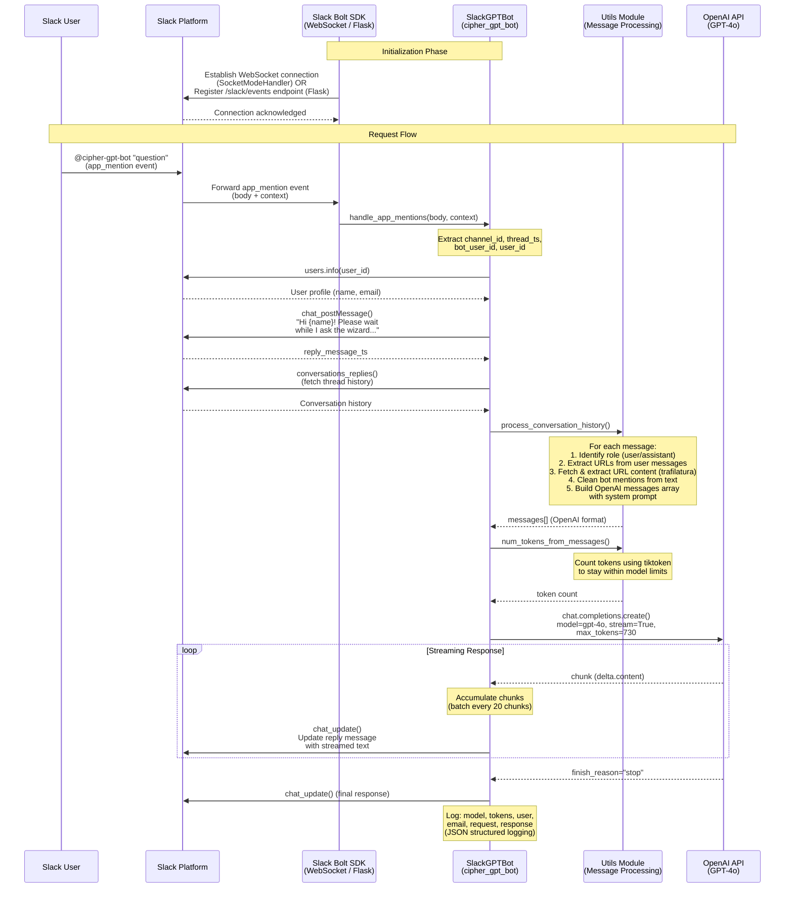

# Slack GPT Bot - Source Code Review & Architecture Report

## Overview

The **slack-gpt-bot** is a CipherHealth internal Slack chatbot (forked from [alex000kim/slack-gpt-bot](https://github.com/alex000kim/slack-gpt-bot)) that integrates Slack with OpenAI's GPT-4o model. Users mention the bot in any Slack channel it has been invited to, and it responds with AI-generated answers — including the ability to read and summarize web page content from URLs included in the message.

---

## Architecture & File Structure

| File | Purpose |
|---|---|
| `main_websocket.py` | **Primary entrypoint.** Connects to Slack via WebSocket (Socket Mode). |
| `main_flask.py` | Alternative entrypoint using Flask HTTP server with a `/slack/events` webhook. |
| `slack_gpt_bot.py` | Core `SlackGPTBot` class — orchestrates Slack interactions and OpenAI API calls. |
| `utils.py` | Utility functions: URL extraction, web scraping, token counting, message processing. |
| `test_utils.py` | Pytest unit tests for URL extraction. |
| `requirements.txt` | Python dependencies. |
| `Dockerfile.websockets` | Docker image for the WebSocket-mode bot (production). |
| `Dockerfile.flask` | Docker image for the Flask-mode bot (alternative). |
| `fly.toml` | Fly.io deployment configuration. |
| `.github/workflows/deploy-to-fly.yaml` | CI/CD: deploys to Fly.io on version tag push. |

---

## Flow Diagram

---

## How It Works — Step by Step

### 1. Initialization (Two Modes)

The bot supports two connection modes to Slack:

- **WebSocket Mode** (`main_websocket.py`) — The **production mode**. Uses Slack's Socket Mode via `SocketModeHandler`, which maintains a persistent WebSocket connection. Requires both `SLACK_BOT_TOKEN` and `SLACK_APP_TOKEN`.

- **Flask/HTTP Mode** (`main_flask.py`) — An alternative mode exposing an HTTP endpoint at `/slack/events`. Slack sends events via HTTP POST using a Request URL. Served by Gunicorn.

Both modes register an `app_mention` event handler that delegates to `SlackGPTBot.handle_app_mentions()`.

### 2. Event Trigger

When a user types `@cipher-gpt-bot <question>` in any Slack channel, Slack emits an `app_mention` event. The Slack Bolt SDK routes this event to the registered handler.

### 3. User Identification & Compliance Logging

The bot calls Slack's `users.info` API to retrieve the requesting user's **username, real name, and email**. This is a CipherHealth-specific addition for compliance — every request and response is logged with full user identity in structured JSON format via `json-logger-stdout`.

### 4. "Please Wait" Message

A personalized placeholder message ("Hi {first name}! I got your request, please wait while I ask the wizard...") is posted as a threaded reply. This message's timestamp (`reply_message_ts`) is saved so it can be **updated in-place** as the response streams in.

### 5. Conversation History Retrieval

The bot fetches the entire thread history using `conversations_replies()`. This enables **multi-turn conversation context** — the bot remembers what was said earlier in the thread.

### 6. Message Processing (`utils.py`)

Each message in the thread is processed:

- **Role assignment**: Messages from the bot are tagged `"assistant"`, others as `"user"`.
- **URL extraction & web scraping**: URLs wrapped in Slack's `<url>` syntax are extracted via regex. The `trafilatura` library fetches and extracts clean text content from those web pages. The extracted content is appended to the user's message.
- **Bot mention cleanup**: `<@BOT_ID>` mentions are stripped from message text.
- **System prompt**: A system prompt (`"You are an AI assistant. You will answer the question as truthfully as possible."`) is prepended to the messages array.

### 7. Token Counting

The `tiktoken` library counts tokens for the assembled messages array. The bot uses **GPT-4o** with a 128,000-token context window. The max response tokens are calculated as `128000 - input_tokens`, though the actual `max_tokens` parameter is hard-set to **730** (~4000 characters, roughly one Slack message).

### 8. OpenAI Streaming Call

The bot calls `openai.chat.completions.create()` with `stream=True`. This returns an iterable of response chunks.

### 9. Real-Time Response Streaming to Slack

As chunks arrive from OpenAI, the bot accumulates them and calls `chat_update()` every **20 chunks** to update the placeholder message in-place. This gives users a live-typing experience. When `finish_reason == 'stop'` is received, a final update is made.

### 10. Structured Logging

After each request, a comprehensive JSON log entry is emitted containing: model used, token counts, channel/thread IDs, user ID, username, email, the request, and the full response.

---

## Key Dependencies

| Library | Role |
|---|---|
| `slack-bolt` | Slack SDK framework — handles events, Socket Mode, and Flask adapter |
| `openai` | OpenAI Python client for GPT-4o API calls |
| `tiktoken` | Token counting for OpenAI models |
| `trafilatura` | Web scraping / content extraction from URLs |
| `Flask` + `gunicorn` | HTTP server (Flask mode only) |
| `json-logger-stdout` | Structured JSON logging (GCP Logging compatible) |

## Environment Variables

| Variable | Purpose |
|---|---|
| `SLACK_BOT_TOKEN` | OAuth bot token (scopes: `app_mentions:read`, `chat:write`, `channels:history`, `users.profile:read`) |
| `SLACK_APP_TOKEN` | App-level token for Socket Mode (`connections:write` scope) |
| `OPENAI_API_KEY` | OpenAI API authentication |

## Deployment

- **Primary**: Docker container on **GCE** (Google Compute Engine) using WebSocket mode — necessary because Socket Mode doesn't work with Cloud Run's request-based model.
- **CI/CD**: GitHub Actions workflow triggers on `v*.*.*` tag pushes, deploying to **Fly.io** via `flyctl`.
- **Container registry**: Images are pushed to `us.gcr.io/qaload-track-atlas-ch-e4e9/slack-gpt-bot`.

## Notable Design Decisions

- **Streaming updates** — Rather than waiting for the full response, the bot updates the Slack message every 20 chunks, creating a real-time typing effect.
- **Thread-aware context** — The bot pulls the full thread history, so follow-up questions within the same thread maintain conversational context.
- **URL content augmentation** — Users can paste URLs and the bot will scrape and incorporate the page content into the prompt.
- **Compliance logging** — Every interaction is logged with user identity (name, email, user ID) for audit purposes — a CipherHealth-specific requirement.
- **Hard-coded response cap** — `max_tokens=730` limits responses to roughly one Slack message length, preventing excessively long responses.
